# Flowchart AI

Flowchart AI is an MIT-licensed, open-source diagram editor with Flowchart, Architecture, and Draw modes. Build diagrams by hand, preview AI proposals, or edit a shared chart with an MCP agent. The canvas works without AI credentials.

[Open the app](https://flowchart.zeroclickdev.ai/) · [Source](https://github.com/tmcfarlane/flowchart) · [Fork](https://github.com/tmcfarlane/flowchart/fork) · [Contribute](CONTRIBUTING.md) · [Self-host](#run-locally-or-self-host) · [v3.0.0 release notes](docs/releases/v3.0.0.md)

[](LICENSE)
[](https://github.com/tmcfarlane/flowchart/stargazers)
[](https://github.com/tmcfarlane/flowchart/issues)

Created by [ZeroClickDev](https://zeroclickdev.ai/).

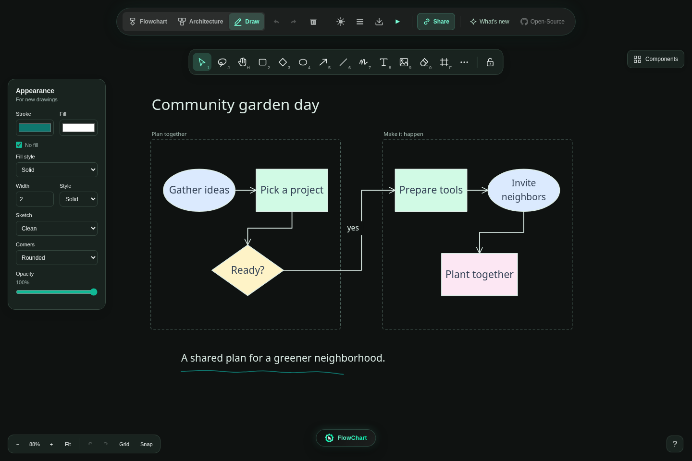

Draw mode with native shapes, bound arrows, labels, and frames.

<p align="center">
  <a href="https://flowchart.zeroclickdev.ai/mcp#trailer">
    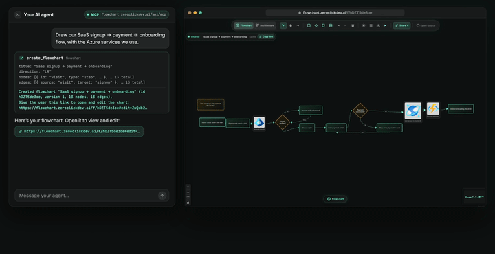
  </a>
  <br />
  <a href="https://flowchart.zeroclickdev.ai/mcp#trailer">Watch the trailer</a> · 56 seconds, sound on
</p>

## Choose your canvas

Each document retains its selected mode, graph, and drawing data.

| Mode | Use it for |
| --- | --- |
| Flowchart | Process steps, decisions, notes, images, and connected workflows. |
| Architecture | Services, databases, queues, containers, protocol-aware connections, and bundled official Azure icons. |
| Draw | Freeform diagrams and annotations in our first-party SVG editor, with editable shapes, paths, labels, images, and frames. |

Draw is implemented in this repository. Excalidraw file support does not require the Excalidraw editor or hosted service. See the [Draw guide](docs/draw-mode.md).

## Features

### Generate and edit with AI

- Choose Flowchart, Architecture, or Draw as the output mode. Review a proposal, refine or regenerate it, then insert it into its chosen canvas.
- AI Draw uses native shapes, text, arrows, lines, pen paths, and frames. The backend measures text, fits shapes, resolves attachments, routes connectors, and validates the finished drawing before preview. Preview and insertion use that same finalized file. See [AI Draw generation](docs/ai-draw-generation.md).
- Preview selected-node edits in Flowchart and Architecture, then apply them as one undoable change. See [selected-node AI edits](docs/selected-node-ai.md).
- Preview scoped text and style edits to existing unlocked Draw objects. Geometry changes are limited to standalone, unassociated rectangles, diamonds, and ellipses. See [selected Draw AI edits](docs/draw-selection-ai.md) for the exact scope.

### Draw and arrange

- Use rectangles, diamonds, ellipses, arrows, lines, pen, text, images, eraser, and frames. Change strokes, fills, hatching, sketch texture, corners, opacity, typography, and arrowheads.
- Resize, rotate, duplicate, copy, paste, group, lock, align, stack, and flip objects. Use box or lasso selection, connected-shape shortcuts, and keyboard editing for connector points.
- Keep labels centered and attached to shapes through movement, resizing, and rotation. Double-click shapes, existing text, or connectors to edit their labels. Readable text colors and visible arrowheads adapt to dark and light canvases.
- Clip and move frame contents together. Save reusable selections in the browser-local Components panel.
- Find objects with drawing search and a command palette. Add element links, inspect statistics, or use view and zen modes. Pan with Hand, Space-drag, or a held right mouse button.
- Use the fading laser, eyedropper, fill, shape recognition, and static HTTPS embed cards. Import the [supported Mermaid flowchart subset](docs/draw-extra-tools.md#mermaid-syntax) as editable objects.
- Upload or paste images, crop from their original pixels, and paste clipboard text as editable text. AI Draw generation does not create image assets.

The [Draw guide](docs/draw-mode.md), [keyboard reference](docs/excalidraw-hotkeys.md), [media guide](docs/draw-media.md), and [extra tools guide](docs/draw-extra-tools.md) cover these controls.

### Save, share, and present

- Autosave standalone documents locally. Import or export editable native JSON with the selected mode and complete drawing, and use shared Undo and Redo across edits, imports, and mode changes.
- Open or insert validated `.excalidraw` files as editable objects in Draw. Export the current Draw board as `.excalidraw`. See [file compatibility and limits](docs/excalidraw-import.md).
- Export PNG, SVG, or GIF. Draw GIF export records one still frame for the chosen duration. Draw presentation shows the whole board with pan and zoom. Flowchart and Architecture retain their graph walkthroughs.
- Share editable chart links. Browser and MCP updates sync within a few seconds, including drawing and mode changes. See the [sharing limits and access model](docs/mcp.md#privacy-and-security).
- Connect Claude, ChatGPT, VS Code, Cursor, or OpenCode through the remote MCP server. The hosted MCP service needs no account or API key.
- Use dark or light themes and compact controls that fit 390px phone viewports, with scrolling palettes and collapsible Draw panels.
- Read release updates in **What's new**, including the v3.0.0 screenshot gallery.

## Screenshots

These v3.0.0 screenshots use public sample diagrams. Open any image to view it at full size.

<details>
<summary>View 9 more screenshots</summary>

### Draw workspace in light mode

The same editable drawing with a light canvas.

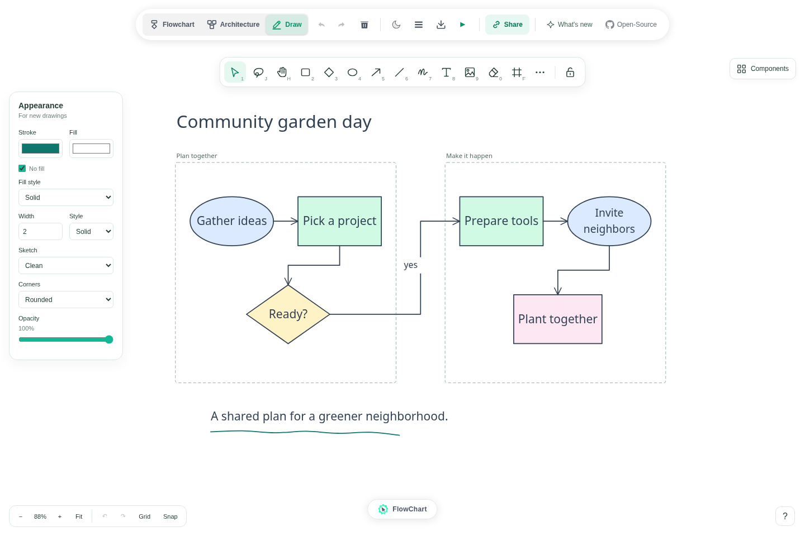

### AI Draw preview

Review a backend-finalized native drawing before insertion. This capture replays a recorded response.

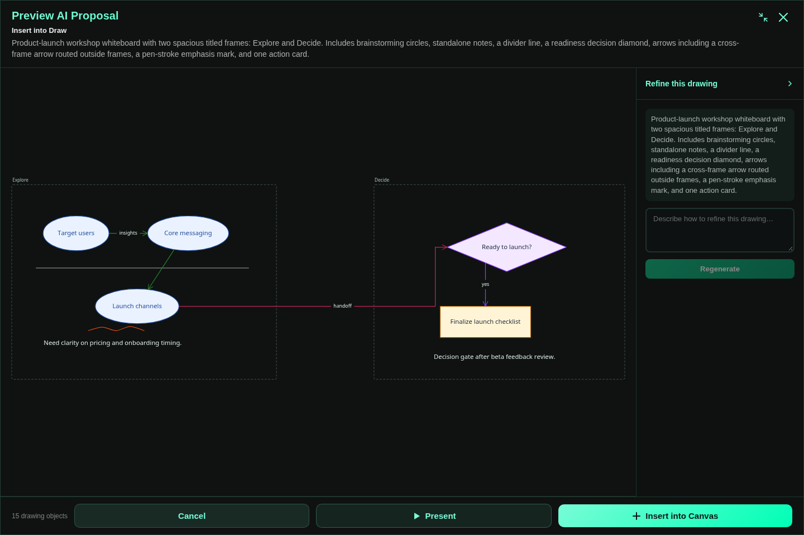

### Selected-object AI preview

Review a scoped edit before applying it. This capture uses a public response fixture.

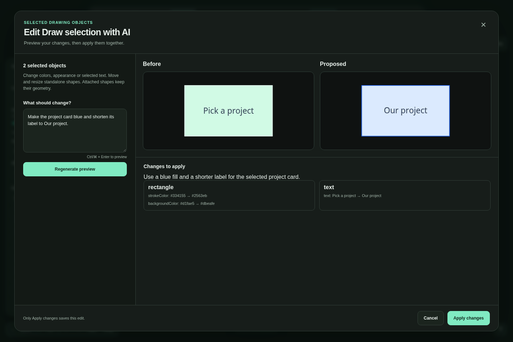

### Shape labels and arrows

Centered labels remain attached to editable shapes.

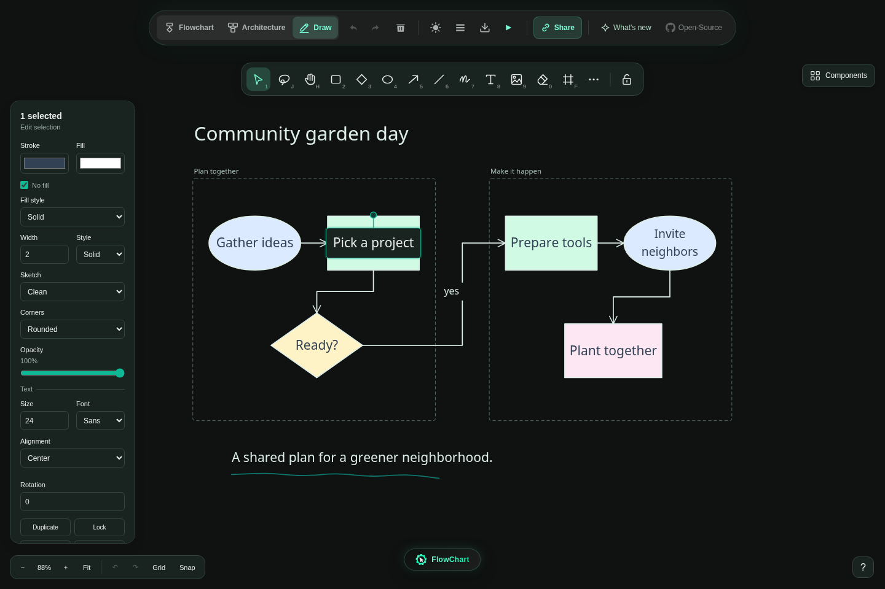

### Components and frames

Reuse saved selections and arrange objects inside native frames.

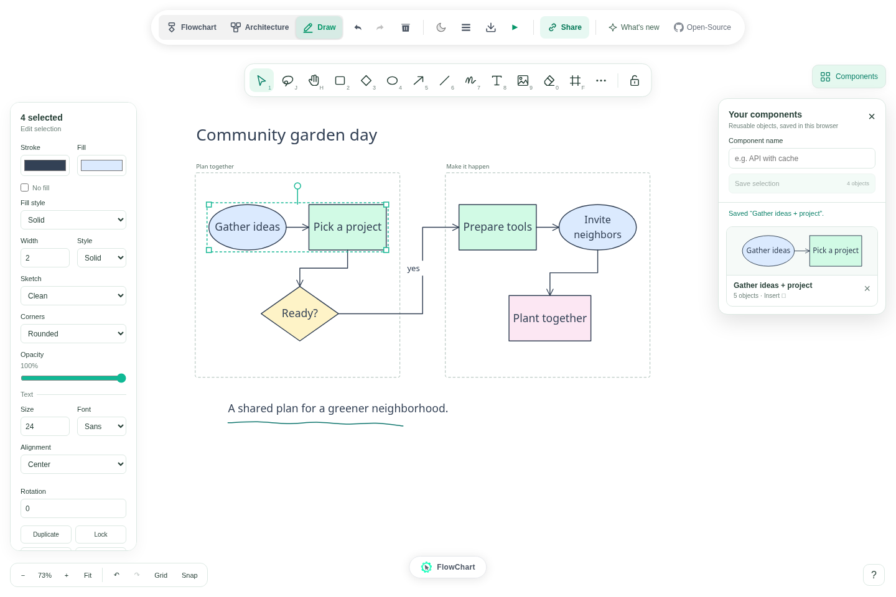

### Draw on a phone viewport

Compact controls, scrolling tools, and collapsible panels fit a 390px-wide viewport.

<a href="public/releases/v3.0.0/mobile-draw-light.png">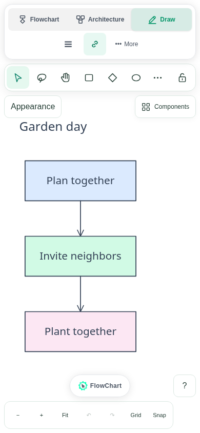</a>

### Architecture mode

Model services, data stores, and their connections on the graph canvas.

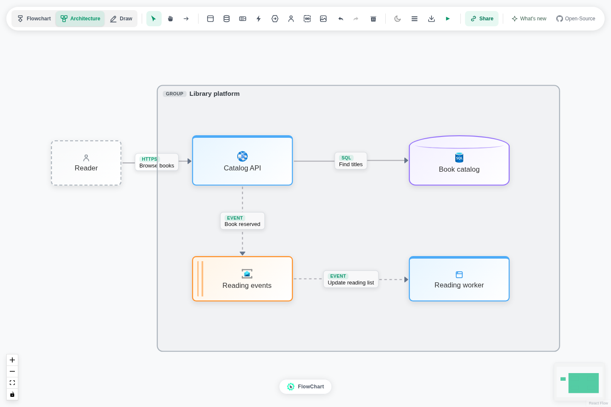

### Editable Excalidraw import

Imported objects remain editable in the first-party Draw editor.

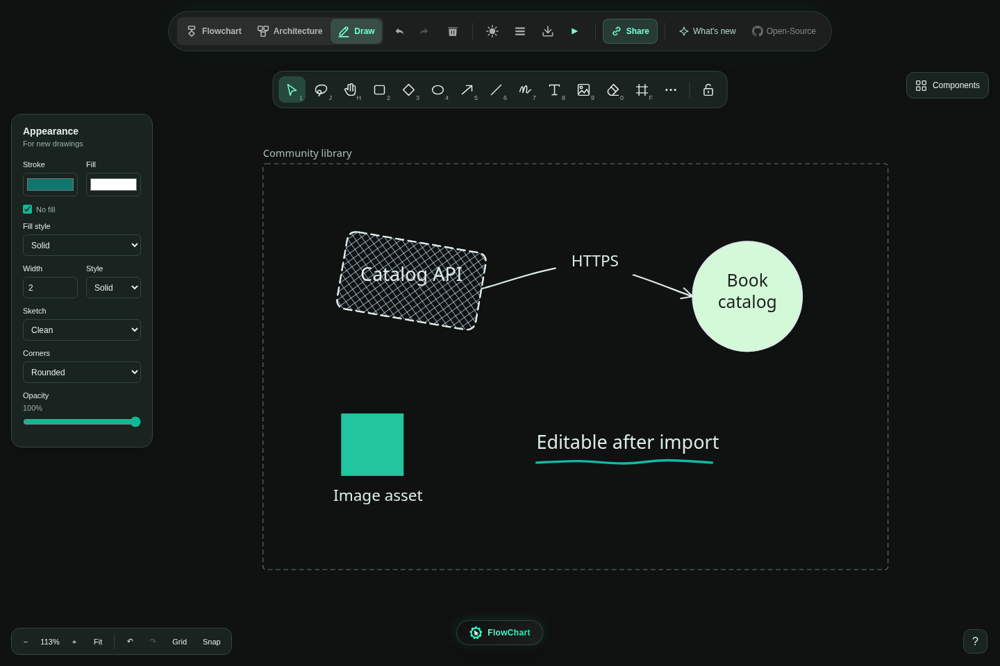

### Flowchart mode

Connect process steps and decisions on the original graph canvas.

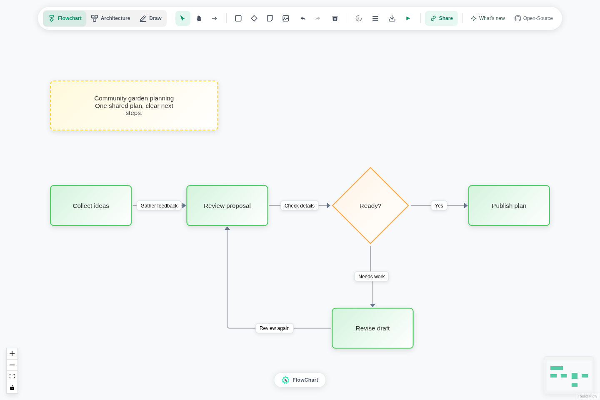

</details>

## Run locally or self-host

Use Node.js 20 or newer and npm. The repository tracks `package-lock.json`.

```sh
git clone https://github.com/tmcfarlane/flowchart.git
cd flowchart
npm ci
npm run dev
```

Open `http://localhost:3004`. The development server serves the canvas and the local API handlers. No environment file or AI credentials are needed for canvas editing. Local shared charts use a file-backed development store when Redis is absent.

Run the automated checks and build the production bundle:

```sh
npm test -- --run
npm run build
```

Self-host the frontend and the `api/` handlers. Production sharing and MCP require your own Redis configuration. Optional AI requires your own server-side provider settings. See the [API deployment guide](api/README.md) and [MCP self-hosting guide](docs/mcp.md#self-hosting).

## Use an MCP agent

Connect your client to the hosted Streamable HTTP endpoint:

```text
https://flowchart.zeroclickdev.ai/api/mcp
```

For Claude Code:

```sh
claude mcp add --transport http flowchart https://flowchart.zeroclickdev.ai/api/mcp
```

The tools are `create_flowchart`, `get_flowchart`, `update_flowchart`, `list_node_types`, and `search_azure_icons`. The agent can create a chart, return an editable link, and keep updating the same chart while you edit in the browser. MCP itself does not call an LLM.

The local endpoint is `http://localhost:3004/api/mcp`. The [MCP launch page](https://flowchart.zeroclickdev.ai/mcp) has client setup, and the [MCP reference](docs/mcp.md) covers tools, REST access, privacy, and limits.

## Configure optional AI

Website generation and refinement use your own Azure deployment through `/api/chat`. AI defaults to disabled.

```sh
cp .env.example .env
```

Set `AI_ROUTING_MODE=direct` for Azure or `AI_ROUTING_MODE=gateway` for your authenticated Cloudflare AI Gateway. Both need `AZURE_RESOURCE_NAME`, `AZURE_DEPLOYMENT_NAME`, `AZURE_API_KEY`, and verified `AI_INPUT_PRICE_PER_MILLION` and `AI_OUTPUT_PRICE_PER_MILLION` values. Gateway mode also needs the `CLOUDFLARE_ACCOUNT_ID`, `CLOUDFLARE_AI_GATEWAY_ID`, and `CLOUDFLARE_AI_GATEWAY_TOKEN` settings.

Keep credentials server-side. Never give them a `VITE_` prefix. Production AI requires Redis-backed admission controls. The official website requires gateway routing with `AI_REQUIRE_GATEWAY=true`. `AI_ENABLED=false` stops inference while canvas editing remains available.

Use [`.env.example`](.env.example) and the [AI configuration guide](api/README.md#apichat) for supported model settings, request limits, budgets, privacy, and deployment checks.

## Contribute

Fork the [source repository](https://github.com/tmcfarlane/flowchart), follow [CONTRIBUTING.md](CONTRIBUTING.md), and open a focused pull request. Report vulnerabilities through [SECURITY.md](SECURITY.md).

The app uses React, TypeScript, Vite, and Vercel-compatible API handlers. It was built with AI assistance using Cursor, OpenCode, and [Oh My Cursor](https://github.com/tmcfarlane/oh-my-cursor).

## License

[MIT](LICENSE). You can use, modify, redistribute, and self-host the project under that license.
