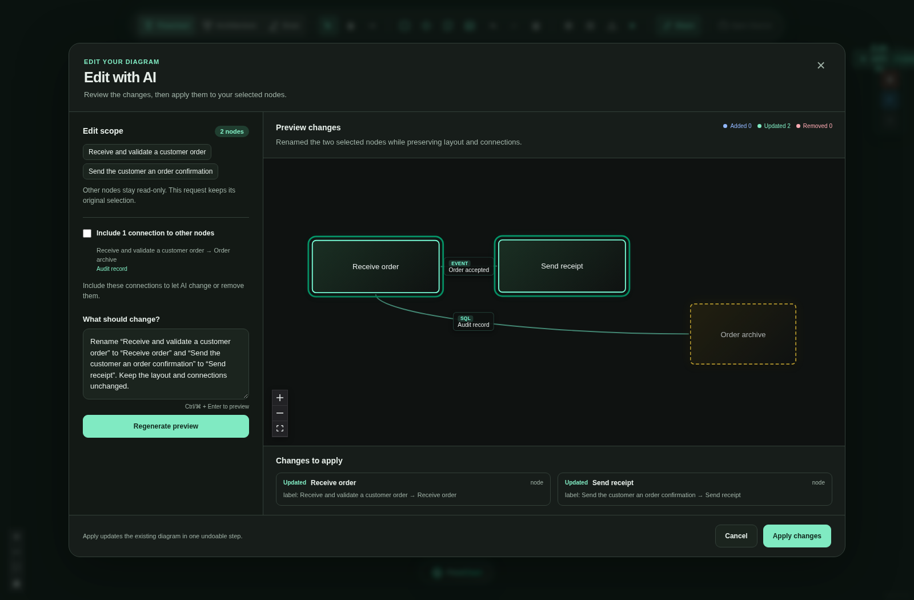
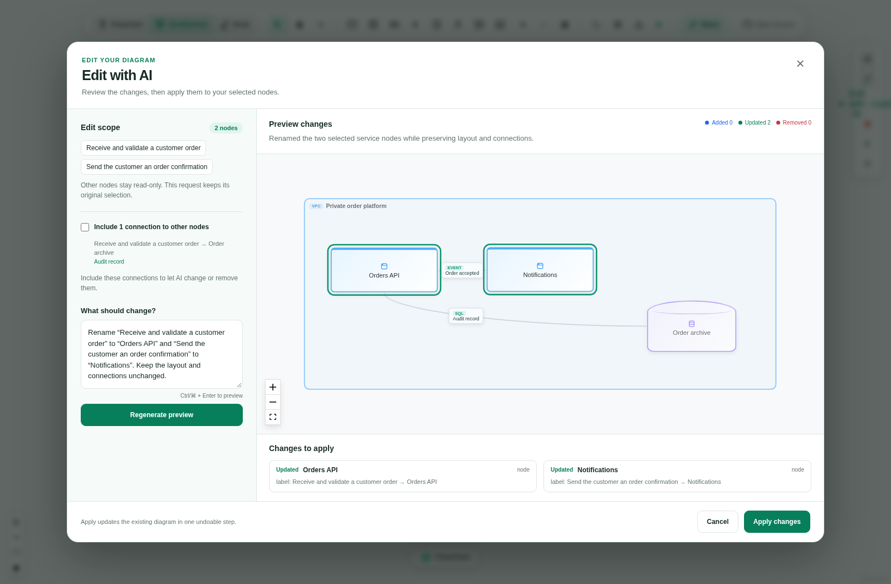
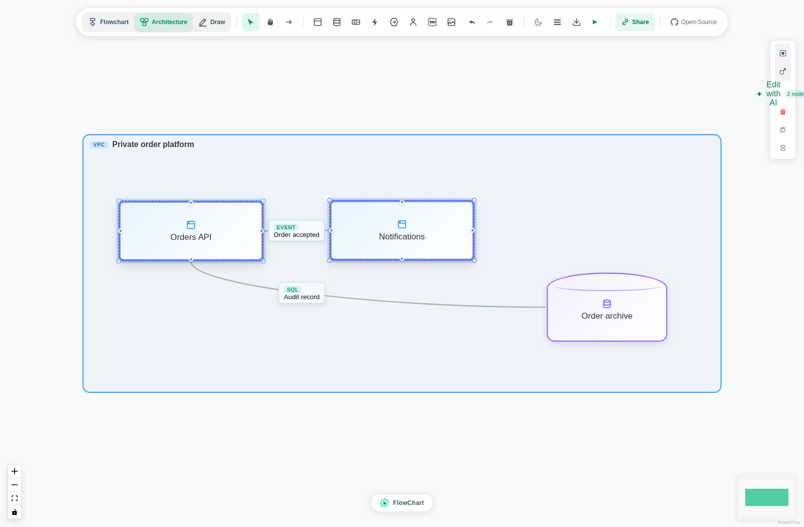

# Edit selected nodes with AI

In **Flowchart** or **Architecture** mode, select one or more nodes and choose
**Edit with AI** in the selection toolbar. The AI assistant offers the same
action with the selected-node count. Describe the change, choose **Preview
changes**, and review the highlighted diagram and change list before choosing
**Apply changes**. Cancel leaves the diagram unchanged.

Renaming two selected services updates those same nodes. Their IDs, precise
positions, dimensions, icons, hierarchy and other metadata remain intact unless
the proposed operations explicitly change them. Draw mode keeps its existing
generation workflow; this feature edits graph nodes in the other two modes.



## Scope and connections

The request captures the selected IDs, a revision marker and an exact snapshot
when it is submitted. Changing the canvas selection while the request runs does
not retarget that request. Nearby nodes and connections are supplied as context
and remain read-only unless deliberately included.

Connections whose endpoints are both selected are included. Connections to
other nodes are listed separately and start unchecked. Choose **Include …
connections to other nodes** to permit edits or deletion of those exact links;
the preview shows affected connections before applying. Including a connection
never makes its unselected endpoint node writable.

Deleting a selected node can remove its included incident connections. It cannot
silently delete other connections, detach unselected children, move unselected
descendants through a container, or resize an ancestor in a way that could clamp
them. Select those children too when the requested edit needs to change their
geometry. New nodes need explicit positions; this flow never automatically
relayouts the existing diagram.



## Review, stale proposals and history

The preview retains the existing diagram positions and marks added, modified
and removed nodes and connections. A separate list describes the fields that
will change. **Apply changes** performs the accepted edits as one undoable
document transaction. Undo/redo, browser autosave, native JSON export and shared
chart autosave use the existing document pipeline, including any retained Draw
scene.

If selected content, incident connections or relevant hierarchy changes while
the request runs or after preview, regenerate before applying. Replacing the
document or adopting a new shared version also invalidates the proposal. A
failed, canceled, invalid or out-of-scope response never mutates the canvas.
An empty-operation answer can explain that no change is needed; Apply remains
disabled.

## API and validation

`POST /api/chat` accepts `mode: "edit"`, `diagramMode: "flowchart" |
"architecture"`, the usual user messages, bounded nearby `flowContext`, and:

```json
{
  "selection": {
    "nodeIds": ["orders", "notifications"],
    "edgeIds": ["orders-notifications"],
    "snapshotId": "opaque-client-snapshot-id",
    "revision": 4
  }
}
```

The existing response envelope contains a JSON message with `summary` and
sparse `operations`, rather than a replacement diagram. Both server and browser
validate operations against the frozen scope, including the patch engine's
implicit side effects. Omitted fields remain unchanged; null explicitly removes
an optional field. The browser checks staleness again on Apply and merges only
accepted field differences into the original editor objects, preserving unknown
metadata and geometry beyond export rounding.

The feature uses the existing authenticated gateway/direct routing policy,
admission limits, budget, timeout and sanitized logging. It does not create a
second inference endpoint. Uploaded image bytes stay out of the AI context;
their existing assets remain available for label-only edits. Deployment names
containing periods are supported as a single Azure URL segment, while resource
host validation and path/query injection checks remain strict.

## Verification

Run `npm test -- --run` and `npm run build`. The focused tests cover selected
scope, boundary connections, container side effects, stale proposals,
cancellation, metadata preservation, both graph modes, atomic history and
shared autosave.

For Chromium verification, run the app and use:

```sh
python scripts/verify-selected-ai.py http://localhost:3014
# Use the server's explicitly configured live provider instead of its UI stub:
SELECTION_EDIT_VERIFY_LIVE_AI=1 python scripts/verify-selected-ai.py http://localhost:3014
```

The live verification used the supplied Azure deployment bindings through the
explicit local **direct** route with memory admission. Nonsecret development
settings were `AI_ENVIRONMENT=selected-edit-local`, input/output prices of
0.25/1 USD per million tokens, a 0.25 USD daily admission budget and one
concurrent request. Production gateway configuration was not changed. Both
Flowchart and Architecture completed two-node edits, Apply/Undo/Redo and JSON
export with no browser errors; the script writes screenshots and a JSON report.


